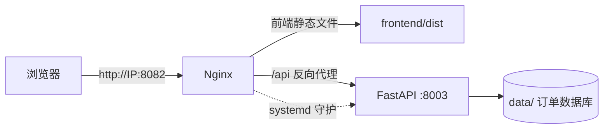

# 📦 订单查重系统 · 云服务器部署指南

> 目标：把「订单查重系统」部署到云服务器上，让同事通过浏览器访问使用。
> 方案：**Ubuntu + Nginx + systemd**，前端构建成静态文件由 Nginx 托管，后端 FastAPI 由 systemd 守护，Nginx 把 `/api` 反向代理到后端。
> 配套文件都在项目 `deploy/` 目录下：`deploy.sh`（一键脚本）、`nginx.conf`、`order-check.service`、`update.sh`。

---

## 一、部署架构



| 服务 | 对外端口 | 内部端口 | 安装路径 | systemd 服务 |
| --- | --- | --- | --- | --- |
| 表格转换 | 8080 | 8004 | /opt/table-converter | table-converter |
| 智能客服 | 8081 | 8002 | /opt/smart-cs-assist | smart-cs-assist |
| **订单查重（本项目）** | **8082** | **8003** | **/opt/order-check** | **order-check** |

> ⚠️ 8080（表格转换）、8081（智能客服）已被占用，本项目固定使用 **8082**。

---

## 二、Git 仓库信息

- 仓库地址：`https://github.com/emendator/Order-check.git`（分支 `main`，私有仓库）
- `.gitignore` 已排除 `data/`、`.venv`、`node_modules`、`frontend/dist`、`工作日报/`、`测试表*.xlsx`
- 线上业务数据（`data/orders.db`）不会进仓库，也不会被 `git pull` 覆盖

---

## 三、一键部署（Git 拉取 + 脚本）

### 3.1 服务器准备

1. 在云厂商控制台「安全组 / 防火墙」放行端口：`22`、`8082`（已开放 8080/8081/8082/8083）
2. 服务器系统：Ubuntu 22.04 LTS（或 20.04 / 24.04）
3. SSH 登录服务器

### 3.2 安装 Git 并配置私有仓库凭据

```bash
apt-get install -y git
git config --global credential.helper store
```

> 私有仓库需要访问令牌（Personal Access Token，勾选 `repo` 权限）。
> 首次 clone/pull 时 Username 填 `emendator`，Password 填 Token（不是 GitHub 登录密码）。

### 3.3 Git 拉取并一键部署

```bash
# 拉取代码（首次会提示输入用户名和 Token）
git clone https://github.com/emendator/Order-check.git /opt/order-check
cd /opt/order-check

# 一键部署，指定 8082 端口
sudo bash deploy/deploy.sh 8082
```

脚本自动完成 7 步：

1. 更新系统、安装 `nginx`、`python3`、`python3-venv`、`git` 等
2. 安装 Node.js 20 LTS，npm 换国内镜像
3. 创建后端 Python 虚拟环境并安装依赖（pip 用清华镜像）
4. 构建前端页面（`npm run build`，产出到 `frontend/dist`）
5. 配置 systemd 服务并启动后端（监听 `127.0.0.1:8003`，开机自启、崩溃自动重启）
6. 配置 Nginx 站点（托管前端 + 反代 `/api`，监听 8082）并启动
7. 配置防火墙（放行 SSH 与 8082）

跑完看到 `✅ 部署完成！` 字样即成功，浏览器访问 `http://你的IP:8082`。

> 首次安装 Node.js、npm install 需要下载依赖，**可能需要几分钟**，属正常现象。

---

## 四、日常更新

### 4.1 本地提交并推送

```bash
cd d:\learn\code\work\订单查重
git add -A
git commit -m "更新说明"
git push origin main
```

### 4.2 服务器拉取并生效

```bash
cd /opt/order-check
git pull origin main
sudo bash deploy/update.sh
```

`update.sh` 会自动：修复权限 → 重新构建前端 → 重启后端。刷新浏览器（Ctrl+F5 强刷）即生效。

> ⚠️ 若 `git pull` 报错 `fatal: detected dubious ownership in repository ...`，先执行一次：
>
> ```bash
> git config --global --add safe.directory /opt/order-check
> ```
>
> 原因：`deploy.sh` 会把项目目录所有者改成 `www-data`，root 对「非本人所有」的 git 仓库会拒绝操作，加白名单即可。

---

## 五、日常运维

### 5.1 常用命令

```bash
# 查看后端实时日志
journalctl -u order-check -f

# 重启后端（更新代码后）
systemctl restart order-check

# 查看 Nginx 错误日志
tail -f /var/log/nginx/error.log

# 改过 Nginx 配置后重载
nginx -t && systemctl reload nginx
```

### 5.2 数据备份（重要）

所有业务数据都在 **`/opt/order-check/data/`**（`orders.db` + `uploads/`）：

```bash
cd /opt/order-check
tar -czf data-backup-$(date +%Y%m%d).tar.gz data
# 然后把 data-backup-*.tar.gz 下载到本地保存
```

> ⚠️ 恢复时把 `data/` 解压回原位置并执行 `chown -R www-data:www-data /opt/order-check/data`。

### 5.3 常见问题

| 现象 | 排查 |
| --- | --- |
| 网页打不开，8082 端口超时 | ① 安全组/防火墙没放行 8082；② 服务器是否已开机；③ 8082 是否被其他进程占用 |
| 网页能开，但上传/查重报错 | `journalctl -u order-check -f` 看后端日志 |
| 上传大文件被拒 | Nginx 已设 `client_max_body_size 50m`，若还报错检查是否有别的代理层限制 |
| `data/` 无法写入 | 权限不对，执行 `chown -R www-data:www-data /opt/order-check/data` |
| `git pull` 卡住/超时（GitHub 不通） | 见下方 §5.4 专项说明 |
| `git pull` 报 `dubious ownership` | 先执行 `git config --global --add safe.directory /opt/order-check` |

### 5.4 GitHub 连接异常专项（2026-08-06 遇到并解决）

**现象**：`git pull origin main` 一直卡住无输出；`curl https://github.com` 超时。

**诊断结果**：服务器 DNS 解析 `github.com → 20.205.243.166`（亚洲节点），该 IP 从服务器**无法连通**；但美国节点 `140.82.112.3 / 140.82.113.3 / 140.82.114.3 / 140.82.121.3` 的 443 端口**全部可连通**（实测 HTTP 200）。

**解决办法**：把 github.com 固定解析到可用的美国节点（写入 /etc/hosts）：

```bash
grep -q "github.com" /etc/hosts || echo "140.82.112.3 github.com" >> /etc/hosts
cd /opt/order-check && git pull origin main
sudo bash deploy/update.sh
```

> 说明：
>
> - hosts 只影响 github.com 主站；git pull 走的是 `github.com` 的 smart HTTP，凭据按 host 匹配，`credential.helper store` 中已存的凭据仍然有效。
> - 若某天 140.82.112.3 也不通，可换用另外几个美国 IP（140.82.113.3 / 114.3 / 121.3）。
> - 备用方案：`ghfast.top`、`gh-proxy.com` 等代理可达（但私有仓库需额外认证，不推荐）。
